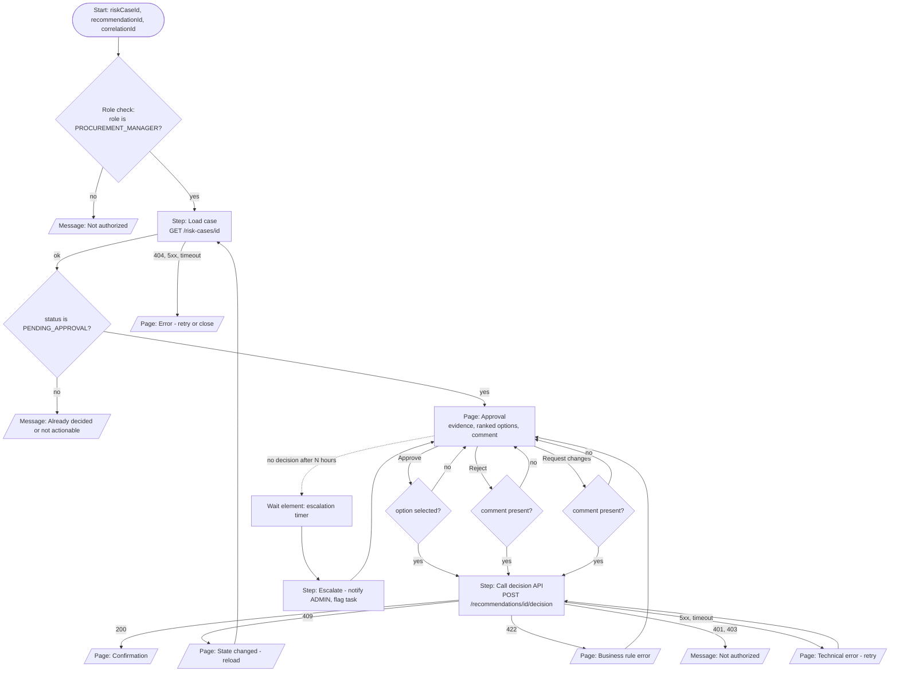

# Approval Flow - build spec (R-06)

Contracts used: CONTRACTS sections 1 (conventions, errors, correlation ID), 2 (roles), 4 (endpoints), 6 (recovery options shape), 7 (state machine), 8 (fallback).

## 1. Map (state diagram)

Re-submitting after a timeout is safe: the endpoint returns `409` if the decision was already recorded, and the Flow then reloads and shows the final state.

## 2. Inputs (Flow start)
Provided by the Boomi process that creates the task: `riskCaseId` (RC-...), `recommendationId` (REC-...), `correlationId` (UUID v4, same as the case so audit lines up).

## 3. Flow values
| Name | Type | Source / use |
|---|---|---|
| `riskCaseId` | String | start input |
| `recommendationId` | String | start input |
| `correlationId` | String | start input; sent as `X-Correlation-ID` on every call; generate UUID v4 if empty |
| `currentUserRole` | String | from Flow identity / `GET /me` |
| `case` | Object | response of Load case; `case.status` must be `PENDING_APPROVAL` |
| `evidence` | List of Object `{source, entity, field, value}` | analysis.evidence |
| `facts`, `assumptions`, `missingData` | List of String | analysis; show missing data honestly |
| `options` | List of Object `{rank, option_type, proposed_action, estimated_lead_time_days, estimated_cost_delta, trade_offs, evidence, assumptions, data_gaps}` | CONTRACTS 6 recovery plan |
| `noViableReason` | String | `no_viable_option_reason` |
| `selectedOption` | Object | row chosen in options table (default rank 1) |
| `decision` | String | `APPROVE` / `REJECT` / `REQUEST_CHANGES`, set by the clicked outcome |
| `comments` | String | textarea |
| `decisionResult` | Object `{decision_status, workflow_ref}` | API response |
| `errorMessage`, `errorCode`, `errorCorrelationId` | String | from the CONTRACTS error body |
| `escalated` | Boolean | set by the escalation step |
| `retryCount` | Number | retry cap |
| `config.*` | String / Number | keys from `values.example.json` |

## 4. Pages
### 4.1 Approval page
Components, top to bottom:
1. Presentation: case header - `riskCaseId`, severity, summary, supplier.
2. Table `Evidence` bound to `evidence` (source, entity, field, value). Below it lists for `facts`, `assumptions`, `missingData` (label missing data clearly, never hide it).
3. Table `Recovery options` bound to `options`, single-select row sets `selectedOption`. Columns: rank, option_type, lead time days, cost delta, trade-offs. Row detail: proposed_action, evidence, assumptions, data_gaps. If `options` is empty show `noViableReason` and hide Approve.
4. Textarea `Comment` bound to `comments`. Required for Reject and Request changes; optional for Approve.
5. Outcome buttons: **Approve** (primary), **Reject**, **Request changes**. Each sets `decision`, then validates, then runs Call decision API.
6. Banner when `escalated` is true.

Validation: Approve needs `selectedOption`; Reject and Request changes need non-empty `comments`.
Body note: the decision body is `{decision, comments}` only. Until N-10 confirms an option field, put the chosen option in `comments` as prefix `Option rank N: ` (open question).

### 4.2 Confirmation page
Shows `decision`, `decisionResult.decision_status`, `decisionResult.workflow_ref`, correlation ID, and a line: Approve = "Execution started", Reject = "No ERP change will be made", Request changes = "Returned for rework". Link to the case in the SaaS Approval Center.

### 4.3 Error pages
Show `errorMessage` and `errorCorrelationId`; buttons Retry / Reload case / Close depending on the error (section 7).

## 5. Service / Connector: `SupplyGuard API`
Type: HTTP / REST Flow Service. Base URL `config.django_base_url` (API Management gateway).

Headers on every action:
- credential header from API Management (section 6)
- `X-Correlation-ID: {correlationId}`
- `Content-Type: application/json`, `Accept: application/json`

| Action | Method / path | Request | Response mapped to |
|---|---|---|---|
| `loadCase` | `GET {base}/risk-cases/{riskCaseId}` | none | `case`, `evidence`, `options`, `facts`, `assumptions`, `missingData`, `noViableReason` (from event, analysis, recommendations) |
| `submitDecision` | `POST {base}/recommendations/{recommendationId}/decision` | `{ "decision": "APPROVE\|REJECT\|REQUEST_CHANGES", "comments": "<text>" }` | `decisionResult` |

Tenant is never sent in body or query; the server derives it from the credential or JWT.

## 6. Authentication through API Management
- Flow never calls Django directly; it calls the API Management gateway (U-09). API Management holds the credential, applies rate limits and forwards `X-Correlation-ID` untouched.
- The credential lives in Boomi as a connection credential; docs and config reference only the name `supplyguard-flow-credential`. Never put the value in git, Flow values or logs.
- Open design point (Nikhil / Uday): `POST .../decision` is `PROCUREMENT_MANAGER` (user JWT) in CONTRACTS 4, while Boomi callers use `SYSTEM` API keys. Preferred: Flow passes the signed-in manager's identity so the audit actor is the human. The Flow role check is a UX guard; Django is the enforcer.

## 7. Error handling
CONTRACTS error body: `{ "error": { "code", "message", "details", "correlation_id" } }`. Always display `message` and `correlation_id`.

| Status / code | Meaning | Flow behaviour |
|---|---|---|
| 200 | decision recorded | Confirmation page |
| 400 `VALIDATION_ERROR` | bad body | back to Approval with message |
| 401 `UNAUTHENTICATED` | credential or session invalid | stop, "sign in again / contact admin" |
| 403 `FORBIDDEN` | role not allowed | Not authorized, no retry |
| 404 `NOT_FOUND` | case or recommendation missing | error page, Close only |
| 409 `CONFLICT` | invalid transition or already decided | reload case; show "already decided as X" if moved on |
| 422 `BUSINESS_RULE` | rule rejected the decision | show message, return to Approval page |
| 502 / 504 / 5xx / timeout | technical | error page with Retry of the same decision; after `max_retries` say "decision not recorded, use SaaS Approval Center" |

Never assume success on a timeout: reload the case before reporting an outcome.

## 8. Role check
Only `PROCUREMENT_MANAGER` may decide (CONTRACTS 2). OPS_MANAGER and VIEWER see nothing actionable. ADMIN is not listed as an approver in the contract, so also not allowed unless CONTRACTS changes. Implemented twice: (1) Flow swimlane/authorization plus the Role check decision at the start of the map; (2) Django enforces on the endpoint (403). Never rely on Flow alone.

## 9. Escalation
- Wait element starts when the Approval page is shown, duration `config.escalation_hours` (default 24, demo ~2 minutes).
- On timeout without a decision: set `escalated = true`, notify `config.escalation_contact_role` (ADMIN) via task reassignment or email, keep the case in `PENDING_APPROVAL` (escalation never approves anything), show the banner, restart the timer once. After a second timeout the task stays escalated and is flagged in the SaaS UI.
- Escalation must be auditable: action `APPROVAL_ESCALATED` with the correlation ID. Flow cannot write audit itself, so the escalation step goes through a Boomi process or an endpoint (open question for Uday).

## 10. Audit events expected within 5 s of a decision
Written by Django (`transition()` writes an AuditEvent on every state change); visible via `GET /audit?correlation_id=<id>`:

| Decision | Events |
|---|---|
| Approve | decision recorded (actor, decision, comments); `PENDING_APPROVAL -> APPROVED`; `APPROVED -> EXECUTING` when U-10 starts; execution created |
| Reject | decision recorded; `PENDING_APPROVAL -> REJECTED` (then ANALYZING or CLOSED by rule); no execution |
| Request changes | decision recorded; case returned for rework per N-10 rules |

Exact action strings belong to Nikhil / Uday; update this table when N-10 and U-05 land.
