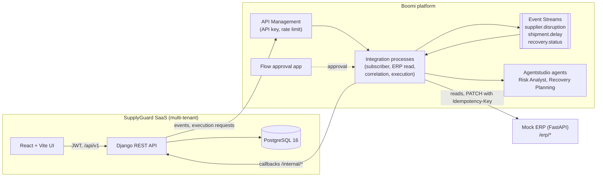
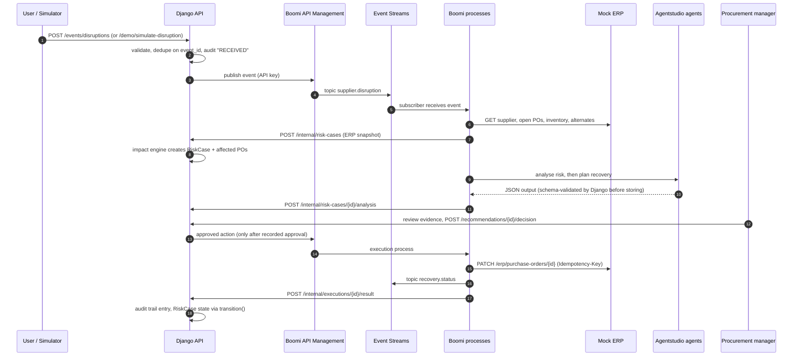

# Architecture

Names of Boomi processes are indicative; see `COMPONENTS.md` for the final component names.

## Components

## Data flow for one disruption

Notes:
- Tenant is taken from the JWT / API key, never from the request body.
- No ERP write happens without a recorded approval.
- RiskCase state changes only through the workflow `transition()` service.
- If Event Streams, Agentstudio, Flow or API Management is unavailable, use the fallbacks in `docs/CONTRACTS.md` section 8.
- The exact hop between Django and the Boomi gateway (publish vs. direct call) follows the U-08/U-09 implementation; confirm this diagram against the final processes. [PLACEHOLDER: verify with Uday]
